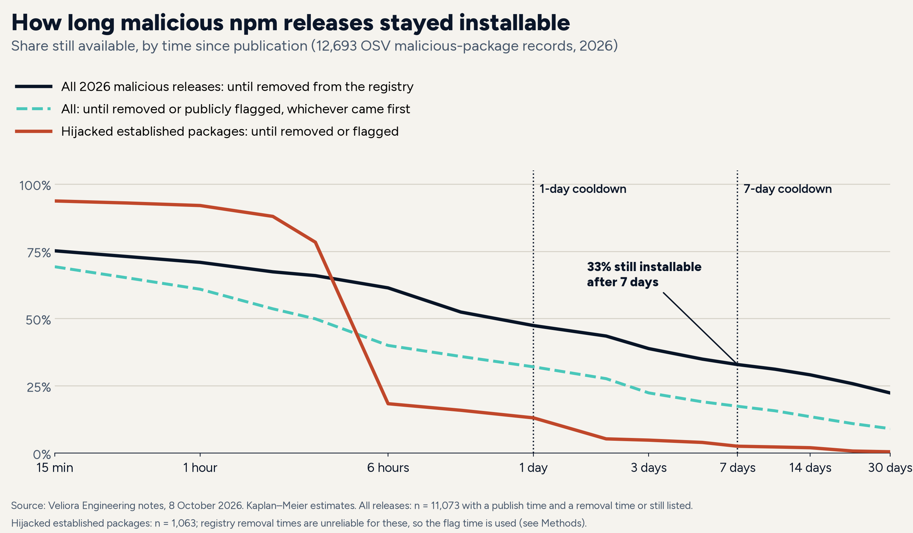

# npm-cooldown

Copy-ready cooldown settings for npm, pnpm, Yarn and Bun, a small script that flags lockfile packages published fewer than N days ago, and the data and method behind a study of whether npm 12 and a cooldown would have stopped 2026's malicious npm releases.

Written up at https://veliora.works/engineering/npm-12-cooldown-2026-attacks/ ("Would npm 12 and a seven-day cooldown have stopped this year's npm attacks?").

A **cooldown** (also called a minimum release age) tells your package manager not to install a version until it has been on the registry for a set time. In 2026, two-thirds of malicious npm releases were removed within a week of publication, so a project with a seven-day cooldown would never have resolved them. Together with npm 12's default block on dependency install scripts, it is a cheap defence against npm supply-chain attacks.

- [Cooldown settings](#cooldown-settings)
- [Check a lockfile: `npm-cooldown`](#check-a-lockfile-npm-cooldown)
- [Results (data snapshot 8 October 2026)](#results-data-snapshot-8-october-2026)
- [How this was tested](#how-this-was-tested)
- [Repository layout](#repository-layout)

## Cooldown settings

The examples use **3 days**. The note's recommendation is a cooldown of a few days, not weeks: one to three days takes most of the benefit for well under a day's average delay on security fixes, and seven days buys a few more points at a cost of 2.5 days on average (see [Results](#results-data-snapshot-8-october-2026)). Change the number to suit you, and keep the unit in mind: **npm counts days, pnpm minutes, Bun seconds, and Yarn takes a duration.**

Every setting name, unit, default and minimum version below was checked against the package manager's own documentation or release notes on 10 October 2026.

| Package manager | Setting | Unit | Default | Minimum version | Exclusions |
|---|---|---|---|---|---|
| npm | `min-release-age` (`.npmrc` or `--min-release-age`) | days | off (`null`) | 11.10.0 | `min-release-age-exclude` (12.0.0) |
| pnpm | `minimumReleaseAge` (`pnpm-workspace.yaml`) | minutes | 1440 (one day) since v11; 0 before | 10.16.0 | `minimumReleaseAgeExclude` |
| Yarn (Berry) | `npmMinimalAgeGate` (`.yarnrc.yml`) | duration, e.g. `"3d"`, `"1w"`; a bare number is minutes | see note below | 4.10.0 | `npmPreapprovedPackages` |
| Bun | `install.minimumReleaseAge` (`bunfig.toml`) | seconds | off (`null`) | 1.3 | `install.minimumReleaseAgeExcludes` |

### npm (11.10.0 or later; npm 12 recommended)

```ini
# .npmrc
min-release-age=3
# packages you maintain yourself, or a fix you need today
min-release-age-exclude[]=@your-org/*
# npm 12 defaults, written out so nobody turns them off by accident
allow-git=none
```

- `min-release-age`: "only versions that were available more than the given number of days ago will be installed." When the window stops `npm audit fix` from installing a patched version, npm keeps the vulnerable version, warns and exits non-zero. To take a fix now, add the package to `min-release-age-exclude`, or relax the setting for one install with `npm install <pkg>@<fixed-version> --min-release-age=0`.
- `min-release-age-exclude`: package names or `minimatch` globs that skip the window. Only the named package is exempt, not its dependencies.
- npm 12.0.0 (8 July 2026) also blocks dependency lifecycle scripts by default unless the root package's `allowScripts` policy allows them, and defaults `allow-git` and `allow-remote` to `none`. Approve scripts one package at a time with `npm install-scripts approve`; approvals are pinned to exact versions by default (`allow-scripts-pin=true`).
- Sources: [npm Docs, config (v12): `min-release-age`](https://docs.npmjs.com/cli/v12/using-npm/config#min-release-age), [`min-release-age-exclude`](https://docs.npmjs.com/cli/v12/using-npm/config#min-release-age-exclude), [`allow-git`](https://docs.npmjs.com/cli/v12/using-npm/config#allow-git), [`allow-scripts-pin`](https://docs.npmjs.com/cli/v12/using-npm/config#allow-scripts-pin); [npm CLI changelog](https://github.com/npm/cli/blob/latest/CHANGELOG.md) (11.10.0: "add min-release-age"; 12.0.0-pre.1: "add min-release-age-exclude config"; 12.0.0: scripts blocked by default).

### pnpm (10.16.0 or later)

```yaml
# pnpm-workspace.yaml
minimumReleaseAge: 4320        # minutes (3 days); pnpm 11+ already defaults to 1440 (1 day)
minimumReleaseAgeExclude:
  - '@your-org/*'
```

- `minimumReleaseAge` "defines the minimum number of minutes that must pass after a version is published before pnpm will install it. This applies to all dependencies, including transitive ones."
- `minimumReleaseAgeStrict` defaults to `true` when you set `minimumReleaseAge` yourself, so pnpm fails resolution instead of falling back to a too-new version. The built-in one-day default is non-strict.
- `minimumReleaseAgeExclude` takes names (10.16.0), patterns such as `'@myorg/*'` (10.17.0) and exact versions such as `nx@21.6.5` (10.19.0).
- Source: [pnpm settings, Dependency Resolution: `minimumReleaseAge`](https://pnpm.io/settings/dependency-resolution#minimumreleaseage).

### Yarn (4.10.0 or later)

```yaml
# .yarnrc.yml
npmMinimalAgeGate: "3d"
npmPreapprovedPackages:
  - "@your-org/*"
```

- `npmMinimalAgeGate`: "Minimum age of a package version according to the publish date on the npm registry to be considered for installation." It is a duration setting whose base unit is minutes, so `4320` and `"3d"` mean the same.
- `npmPreapprovedPackages`: package descriptors or name globs excluded from the package gates.
- Default: the option shipped in Yarn 4.10.0 defaulting to `0m` (off). Yarn's current source sets the default to `1d`. Check what your version does with `yarn config get npmMinimalAgeGate`, and set it explicitly.
- The setting was added in Yarn 4.10.0, so Yarn Classic (1.x) doesn't have it.
- Sources: [Yarn settings (.yarnrc.yml): `npmMinimalAgeGate`](https://yarnpkg.com/configuration/yarnrc#npmMinimalAgeGate), [Yarn 4.10.0 release notes](https://github.com/yarnpkg/berry/releases/tag/%40yarnpkg%2Fcli%2F4.10.0) ("implement `npmMinimalAgeGate` and `npmPreapprovedPackages`", [PR #6901](https://github.com/yarnpkg/berry/pull/6901)), [setting definition in the Yarn source](https://github.com/yarnpkg/berry/blob/master/packages/plugin-npm/sources/index.ts).

### Bun (1.3 or later)

```toml
# bunfig.toml
[install]
minimumReleaseAge = 259200   # seconds (3 days)
minimumReleaseAgeExcludes = ["@your-org/shared"]
```

- `install.minimumReleaseAge`: "Configure a minimum age (in seconds) for npm package versions. During installation, Bun filters out package versions published more recently than this threshold. Default `null` (disabled)."
- `install.minimumReleaseAgeExcludes`: "An array of package names that are exempt from the `minimumReleaseAge` check." The docs describe package names; they don't mention glob patterns.
- Sources: [Bun docs, bunfig.toml: `install.minimumReleaseAge`](https://bun.com/docs/runtime/bunfig#install-minimumreleaseage), [Bun 1.3 release notes](https://bun.com/blog/release-notes/bun-v1.3.0) ("Minimum release age").

### Things a cooldown does not do

- It only matters when a version is **resolved**: a fresh install, a lockfile update or a bot PR. A lockfile already pinned to a clean version is safe whatever the setting. Install from the lockfile in CI (`npm ci`), so the cooldown is applied once, by a person, when dependencies are updated.
- It does nothing about malicious releases that stay on the registry. In the 2026 data, 675 releases flagged as malicious were still listed on 8 October 2026. That needs a scanner or registry proxy that reads OSV or GitHub malware advisories.
- Give security fixes a fast path (the exclusion settings above, or a one-off override), and keep Dependabot or Renovate security updates outside the cooldown.

## Check a lockfile: `npm-cooldown`

`npm-cooldown` reads a lockfile and lists every package whose locked version was published on the registry fewer than N days ago (default 7). Use it to see what a cooldown would hold back, or to check a dependency-update PR that was resolved without one. It has no dependencies and only requests package metadata, never a package tarball.

Requirements: Node.js 18.17 or later. Lockfiles: `package-lock.json` / `npm-shrinkwrap.json` (lockfileVersion 3 and 2, plus 1) and `pnpm-lock.yaml` (lockfile v9, v6 and v5.x). Yarn and Bun lockfiles are not read yet.

```sh
git clone https://github.com/Veliora-pte-ltd/npm-cooldown.git
node npm-cooldown/bin/npm-cooldown.js path/to/package-lock.json            # 7-day cooldown
node npm-cooldown/bin/npm-cooldown.js path/to/pnpm-lock.yaml --days 3
node npm-cooldown/bin/npm-cooldown.js package-lock.json --json > report.json
```

```text
Checked 61 packages from package-lock.json against https://registry.npmjs.org/ (cooldown: 7 days).

20 packages were published less than 7 days ago:
  vite@8.3.4                                    published 2026-10-08T12:07Z  (1.9 days ago)
  rolldown@1.2.13                               published 2026-10-07T14:20Z  (2.8 days ago)
  ...
```

| Option | Meaning |
|---|---|
| `[lockfile]` | Path to the lockfile. Defaults to `./package-lock.json`, `./npm-shrinkwrap.json`, then `./pnpm-lock.yaml`. |
| `-d, --days <n>` | Cooldown in days; decimals allowed (`--days 0.5`). Default 7. |
| `-r, --registry <url>` | Registry to query. Defaults to `$npm_config_registry`, then `https://registry.npmjs.org/`. Registries that need a login are not supported. |
| `-c, --concurrency <n>` | Parallel registry requests. Default 8. |
| `--json` | Machine-readable output: `flagged`, `unknown`, `errors`, counts. |
| `--strict` | Also exit 1 when a version has no publish time or a request fails. |

Exit codes: `0` nothing flagged, `1` at least one package is newer than the cooldown, `2` usage or read error. That makes it usable as a CI step on dependency-update PRs:

```yaml
# GitHub Actions step
- run: node npm-cooldown/bin/npm-cooldown.js package-lock.json --days 3
```

What it skips: the root project, workspace packages and links, bundled dependencies, and git, file and tarball-URL dependencies (they have no registry publish time). Packages the registry no longer has, or versions without a publish time, are listed separately as "check these by hand"; a version missing from the registry can mean it was unpublished.

Tests: `npm test` runs the offline tests (lockfile parsing for each format, the age check against recorded vite publish times, the CLI). `npm run test:live` adds one check against the public registry.

## Results (data snapshot 8 October 2026)

These are the note's findings, computed by the scripts in `method/` from the files in `data/`. The full write-up, with charts and discussion, is the [note](https://veliora.works/engineering/npm-12-cooldown-2026-attacks/). `method/checks/verify_note.py` checks every number in the published note against `data/results/summary.json`; on 10 October 2026 it found all 99 phrases.

**Population.** Every npm `MAL-` record published in the OSV database between 1 January and 8 October 2026: 12,856 records, minus 163 withdrawn, leaves 12,693 records in 12,692 packages.

**How long malicious releases stayed installable.** The median release was removed 10.8 hours after publication. A quarter were gone within about five minutes, and a quarter were still up after 13 days.

Share of all 2026 malicious releases a cooldown would have skipped (95% Wilson intervals; about 11,060 records per row):

| Cooldown | Removed in time | Removed or flagged in time | Hijacked established packages, removed or flagged |
|---|---|---|---|
| 1 hour | 29% (28%–30%) | 39% | 8% |
| 1 day | 53% (52%–54%) | 68% | 87% |
| 3 days | 61% (60%–62%) | 78% | 95% |
| 7 days | 67% (66%–68%) | 83% | 97% |
| 14 days | 71% (70%–72%) | 86% | 98% |

"Removed in time" counts a release as stopped only if npm had removed it before the cooldown ended. "Removed or flagged" also counts releases that were publicly flagged by then, which only helps if your tooling refuses flagged versions; npm does not do that on its own.

**npm 12's install-script block.** 5,822 of the 12,693 advisories (46%) say how the code runs. Of those, 3,089 (53%, 95% interval 52%–54%) run only through install-time scripts, which npm 12's default would have stopped. Across all records that is at least 24%; the share for the 6,871 advisories that don't say is unknown.

**Both together.** Where both the execution path and the seven-day outcome are known, 30% would have been stopped by both npm 12 and a seven-day cooldown, 19% only by npm 12, 36% only by the cooldown, and 15% by neither. What gets past both is mostly code that runs on import, in packages that stayed on the registry for more than a week.

**Hijacked established packages** (specific bad versions of a package with at least five earlier versions, the first at least 90 days older): 1,063 records. Of the 854 with a known execution path, 824 (96%) ran only at install time or through a git dependency, both blocked by npm 12's defaults. The median time to removal or public flag was 3.7 hours. Only 4 of the 854 would have got past both npm 12 and a seven-day cooldown.

**pnpm's one-hour claim.** pnpm's docs say malicious releases are usually removed "within an hour". In this data, 29% were.

**The cost: security fixes arrive later.** 761 advisory rows (advisory, package, first fixed version) in the 1,000 most-depended-on npm packages, October 2025 to September 2026:

| Cooldown | No extra wait | More than 3 days late | Mean extra wait | When late, median |
|---|---|---|---|---|
| 1 day | 76% | 0% | 0.2 days | 0.9 days |
| 3 days | 64% | 0% | 0.8 days | 2.6 days |
| 7 days | 51% | 38% | 2.5 days | 6.0 days |
| 14 days | 42% | 53% | 6.3 days | 12.8 days |

96% of those fixes were published before their advisory went public, which is why the cost is lower than it sounds.



### Limitations

- **OSV is not every attack.** Malicious releases nobody reported are missing, and those are exactly the ones a cooldown cannot help with. Campaigns make the counts lumpy: by month, the seven-day share ranges from 49% (May) to 83% (January).
- **Removal times are reconstructed from registry metadata.** For 639 records the only signal was the package's last-modified date, an upper bound. 672 removed releases have no recoverable removal time and 948 records had no registry metadata; they are left out of the timing shares. Across the robustness checks, the seven-day figure ranges from 58% to 69%.
- **One change after seeing the data.** For hijacked established packages the last-modified fallback can be months late, so for that subset only the headline figures count the public flag as the end of exposure. Removal alone gives a lower bound of 43% at seven days. `method/PREREGISTRATION.md` records this amendment.
- **Flag times are imperfect.** 823 OSV records have a date-only publication time (end of that day was used); 205 were flagged before their recorded publication time.
- **Execution paths come from advisory text**, not from running code, and 54% of advisories don't say. The hand checks are small (51 of 60 exact; 53 of 60 on the npm 12 question). One campaign was coded from a vendor postmortem and applied to the whole wave.
- **"Stopped" assumes the defaults stay on.** Approve every script, or set `dangerously-allow-all-scripts`, and npm 12 protects nothing.
- **The fix-delay measure is a model.** It assumes you would install a fix as soon as both the fix and the advisory exist.
- **The app run is small**: 7 usable apps, one commit each, builds but not tests, no npm 11 baseline.

## How this was tested

- **Malicious packages:** OSV npm dump (`all.zip`, last modified 8 October 2026 16:48 UTC, 218,037,964 bytes; sha256 in `data/osv-npm-all.zip.sha256`). Every `MAL-` record published in 2026.
- **Registry data:** npm registry metadata (packuments) for all 12,692 affected packages, fetched on 8 October 2026 and kept in trimmed form (times, version list, dist-tags; no tarball links) in `data/packuments.jsonl`. **Metadata only: no package tarball was downloaded, unpacked or run.** `method/scripts/timing.py` refuses any URL that could point at a tarball.
- **Definitions:** publication = registry time of the first malicious version (package creation for whole-package records); removal = npm's unpublish time, else the `-security` placeholder time, else last-modified when the bad versions are gone; flag = first appearance in OSV or one of its sources. A cooldown of N days stops a release if it was removed less than N days after publication. npm 12 stops a release if its advisory says the code runs through an install-time hook or a git dependency and nothing else. The questions, definitions and success criteria were written down before the full analysis (`method/PREREGISTRATION.md`).
- **Classifier and hand checks:** rule-based, negation-aware classifier over advisory text (`method/scripts/osv_census.py`), checked by hand on 60 labelled and 30 "unclear" records; the largest campaigns were coded by hand (`data/results/manual_codes.json`).
- **Security fixes:** 4,442 GitHub-reviewed npm advisory rows published 1 October 2025 to 30 September 2026, joined to registry publish times (`method/scripts/fix_delay.py`); package popularity from ecosyste.ms (`data/top1000.json`).
- **Cooldown behaviour on a real package:** with `min-release-age=7`, npm 12.2.0 resolved vite to 8.3.2 instead of that day's 8.3.4; pnpm 12.10.1 resolved 8.3.3 by default and 8.3.2 at 10,080 minutes (`data/results/cooldown-check.txt`).
- **App run (secondary):** 10 open-source apps installed with npm 12.2.0 on Node.js 24.21.0 in a bubblewrap sandbox with no credentials (`method/scripts/friction*.py`, `data/results/friction*.json`).
- **Tools and cost:** Python 3 for the analysis; no paid APIs or models; US$0.

### Reproduce

From the repository root:

```sh
python3 method/scripts/analyse.py            # data/ -> data/results/summary.json (every number in the note)
python3 method/checks/verify_note.py         # compares the live note against summary.json
python3 method/scripts/charts.py             # data/charts/*.png (needs matplotlib and Pillow)
```

`analyse.py` uses only files in this repository and reproduces the published `summary.json` exactly. The earlier steps rebuild those inputs from the OSV dump and the live registry:

```sh
python3 method/scripts/osv_census.py npm-all.zip data/results/mal2026.jsonl data/results/census-summary.json
python3 method/scripts/timing.py data/results/mal2026.jsonl data/results/timing.jsonl data/packuments.jsonl
python3 method/scripts/fix_delay.py npm-all.zip data/results/fix_delay.jsonl
OSV_MAL_DIR=<unpacked MAL-*.json records> python3 method/scripts/validation_sample.py
```

### What is not in this repository (to be re-run)

- **The OSV dump itself.** The 218 MB snapshot is over GitHub's file-size limit and is not redistributed. Its sha256 is in `data/osv-npm-all.zip.sha256`. OSV updates the dump continuously, so running `osv_census.py` and `fix_delay.py` on today's dump gives a new snapshot, not the 8 October one: **to be re-run** against a dated new snapshot rather than compared number for number.
- **Registry state.** `timing.py` and `fix_delay.py` read the live registry; packages removed since 8 October will differ. The trimmed 8 October packuments are kept in `data/packuments.jsonl`.
- **Names of releases still listed on 8 October 2026.** The note reports these as counts only, so the 802 records whose malicious versions were still installable at the snapshot (675 of them not withdrawn) carry opaque ids (`REDACTED-…`) and package names (`redacted-…`) in every file here, and their advisory excerpts are withheld. The analysis gives identical results with the redacted files. Campaign matches, which need the advisory text, are precomputed in `data/campaign-assignments.json`.
- **The vite cooldown check** was run by hand in a sandbox; its output is in `data/results/cooldown-check.txt`, but there is no script for it. **To be re-run** if you need it on current versions.
- **The check that npm 12 gates `binding.gyp` builds** was a reading of npm 12.2.0's source (recorded in `data/results/manual_codes.json`), not a test.
- **The chart font** (Figtree) is not included; `charts.py` falls back to the default font.

## Repository layout

```text
bin/npm-cooldown.js        CLI
src/                       lockfile parsers, registry client, age check
test/                      node:test tests and lockfile fixtures
data/                      inputs kept from the 8 October 2026 run (packuments, top 1,000 list, app list)
data/results/              outputs: per-record timing, classifier output, fix delays, app run, summary.json
data/charts/               the note's charts
method/scripts/            the analysis scripts (Python 3, standard library except charts.py)
method/checks/             verify_note.py: every number in the note against summary.json
method/PREREGISTRATION.md  questions, definitions and the one amendment made after seeing the data
```

Data sources: [OSV](https://osv.dev/) (malicious-package and GitHub-reviewed advisories; see each record's source for its licence), the [npm registry](https://registry.npmjs.org/), and [ecosyste.ms](https://packages.ecosyste.ms/). The code is MIT licensed (see `LICENSE`).

---

Maintained by Veliora (https://veliora.works/)
